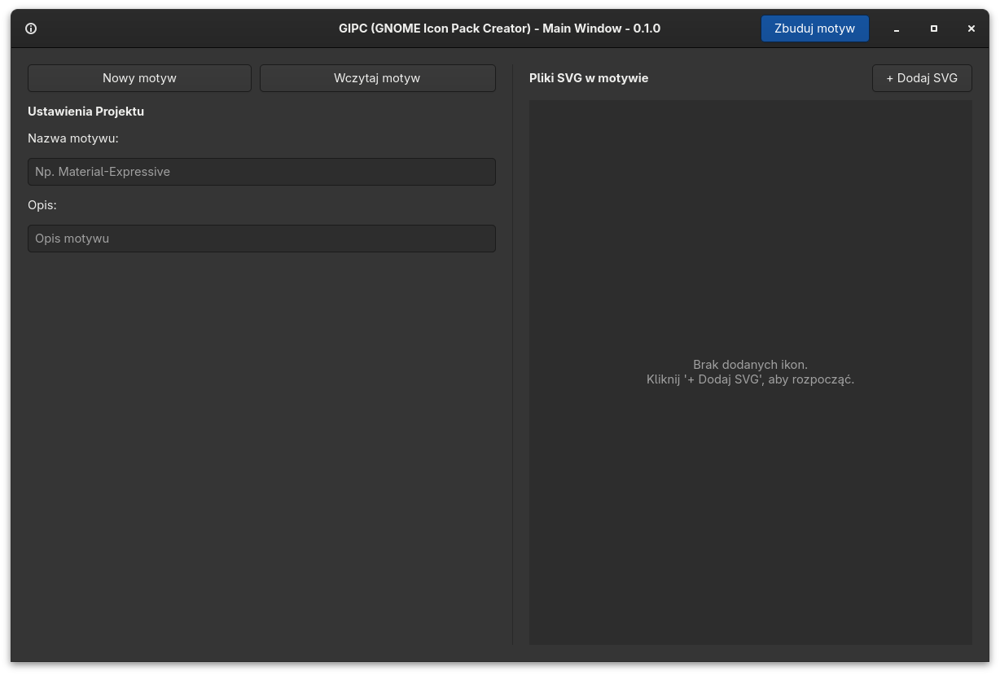
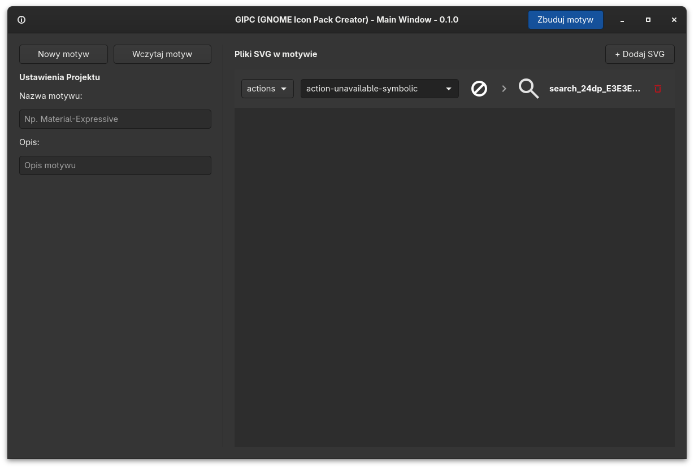

# GIPC — GNOME Icon Pack Creator


Natywna aplikacja graficzna (**GTK 4**) dla systemów Linux (GNOME oraz środowiska zgodne ze specyfikacją Freedesktop), automatyzująca tworzenie, edycję i kompilację własnych motywów ikon z plików `.svg`.

Zamiast ręcznie tworzyć strukturę katalogów `scalable/*`, pisać plik `index.theme` i odświeżać pamięć podręczną ikon, GIPC pozwala wizualnie przypisać własne pliki wektorowe do nazw systemowych oraz ikon zainstalowanych aplikacji.




## Funkcje

- **Wizualne mapowanie `Ikona systemowa → Nowa ikona`:** podgląd na żywo zastępowanej ikony systemowej obok nowego pliku `.svg`.
- **Automatyczne indeksowanie w tle:** skanowanie plików `.desktop` (`/usr/share/applications`, `~/.local/share/applications`) oraz ikon bazowych (`Adwaita`) z podziałem na konteksty Freedesktop (`apps`, `places`, `status`, `devices`, `actions`, `mimetypes`, `categories`, `emblems`, `ui`).
- **Edycja istniejących motywów:** wczytywanie gotowych katalogów z `~/.local/share/icons/`, aktualizacja metadanych oraz automatyczne usuwanie osieroconych plików `.svg`.
- **Walidacja i kompilacja:** sprawdzanie poprawności składni XML/SVG przed dodaniem, wykrywanie duplikatów mapowań, generowanie `index.theme` oraz odświeżanie cache poleceniem `gtk-update-icon-cache`.
- **Wielojęzyczność (PL / EN):** automatyczne wykrywanie języka systemu, możliwość przełączania języka interfejsu w locie w pasku nagłówka oraz trwałe zapamiętywanie wyboru.

## Wymagania systemowe

Poza Pythonem w wersji 3.10 lub nowszej wymagane są biblioteki systemowe **GTK 4** oraz wiązania **PyGObject**:

- **Arch Linux / CachyOS:**
  ```bash
  sudo pacman -S python python-gobject gtk4
  ```
- **Fedora:**
  ```bash
  sudo dnf install python3 python3-gobject gtk4
  ```
- **Ubuntu / Debian:**
  ```bash
  sudo apt install python3 python3-gi python3-gi-cairo gir1.2-gtk-4.0
  ```

## Instalacja i uruchomienie

```bash
git clone https://github.com/macina222/gnome-icon-pack-creator.git
cd gnome-icon-pack-creator

# Utworzenie środowiska wirtualnego z dostępem do systemowego PyGObject
python -m venv .venv --system-site-packages
source .venv/bin/activate
pip install -e . --no-build-isolation

# Uruchomienie aplikacji
gipc
```

> **Wskazówka:** Skompilowany motyw trafia do katalogu `~/.local/share/icons/<nazwa-motywu>`. Możesz go aktywować w aplikacji **Dostrajanie (GNOME Tweaks)** lub poleceniem:
> ```bash
> gsettings set org.gnome.desktop.interface icon-theme "<nazwa-katalogu-motywu>"
> ```

## Architektura projektu

```text
gnome-icon-pack-creator/
├── docs/
│   ├── main_window.png        # Zrzuty ekranu interfejsu
│   └── main_window_with_icon.png
├── src/
│   ├── __init__.py            # Metadane i wersja aplikacji
│   ├── __main__.py            # Punkt wejścia dla `python -m src`
│   ├── config.py              # Stałe, ścieżki bazowe i słownik kontekstów Freedesktop
│   ├── i18n.py                # Moduł internacjonalizacji, wykrywanie i zapisywanie języka
│   ├── locales/               # Pliki tłumaczeń JSON (pl.json, en.json)
│   ├── core/
│   │   ├── icon_database.py   # Agregacja i sortowanie podpowiedzi nazw ikon
│   │   ├── project.py         # Tworzenie, wczytywanie, zapis i usuwanie projektów (index.theme)
│   │   ├── scanner.py         # Skaner plików .desktop oraz systemowych motywów ikon
│   │   └── svg_handler.py     # Walidacja XML/SVG oraz zarządzanie plikami w scalable/
│   └── ui/
│       └── main_window.py     # Interfejs GTK 4, przełączanie języka i okna dialogowe
└── tests/                     # Testy jednostkowe warstwy core oraz i18n (unittest)
```

## Uruchamianie testów

```bash
python -m unittest discover -s tests -v
```

## Plan rozwoju (Roadmap)

- [x] Tłumaczenie aplikacji i wybór języka `PL / EN`
- [ ] Wybór motywu dziedziczonego (`Inherits`) z listy motywów zainstalowanych w `/usr/share/icons`.
- [ ] Obsługa aliasów: tworzenie dowiązań symbolicznych (`symlink`) dla wielu nazw systemowych wskazujących na ten sam plik `.svg`.
- [ ] Automatyczna konwersja ikon na wariant symboliczny (`-symbolic.svg` z atrybutem `currentColor`) dla górnego paska GNOME Shell.
- [ ] Pakietowanie dla AUR (Arch/CachyOS) oraz Flatpak.

## Współpraca

Zachęcam do kontaktu i pomocy przy rozwoju projektu. Zachęcam do załączania propozycji funkcji oraz poprawek błędów :)

## Licencja

Projekt udostępniany na licencji [MIT](LICENSE) — © 2026 Maciej Zych (`Macina222`).
